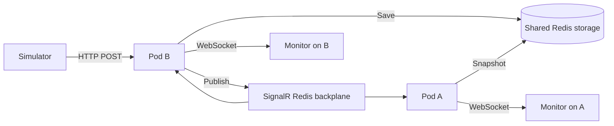

# Ledger - Real-Time Financial Monitor

A transaction simulator and live dashboard built with
.NET, React, TypeScript and SignalR. The assignment is about receiving transactions from an external system and showing them to support agents as they arrive.

There are two screens:

- `/add` creates mock transactions, sends a burst of 100, and lets you complete or fail an existing pending transaction.
- `/monitor` shows the live feed, status counts, filters and search. It shows 10 transactions per page, with the latest accepted change first.

The default setup keeps data in memory. Redis mode adds shared storage and live updates across multiple backend instances.

## Run locally:

You need the .NET 8 SDK and either Node.js 22 (version 22.12 or later) or Node.js 24 or newer. Check that `dotnet`, `node` and `npm` are available in your terminal.

From the project root, start the backend:

```sh
dotnet run --project backend/FinancialMonitor.Api
```

In another terminal, start the frontend:

```sh
cd frontend
npm ci
npm run dev
```

Open the [monitor](http://127.0.0.1:5173/monitor) and [simulator](http://127.0.0.1:5173/add) in separate tabs. The API runs on `http://127.0.0.1:5080`. Vite forwards API requests and WebSocket connections to it.

Local mode uses `Storage:Provider=Memory` from `appsettings.json`. It needs no database setup, and restarting the backend clears its transactions. Use a fresh terminal if you previously set Redis environment variables, or set `Storage__Provider` back to `Memory`.

On Windows, use `npm.cmd` if PowerShell blocks `npm.ps1`. Stop the servers with `Ctrl+C`.

### Try the transaction flow:

1. Keep the monitor open on **All transactions**.
2. In the simulator, choose **Pending** and click **Send transaction**.
3. Find the transaction under **Resolve pending transactions**.
4. Click **Complete** or **Mark failed**.

The monitor updates the same row. The ID, amount and currency stay the same, and the transaction count doesn't increase. The **Run Pending -> Completed demo** button shows this flow automatically with a two-second delay.

The API stores reported payment statuses. it doesn't process payments itself. A normal Pending transaction waits for an explicit update. An invalid request or a network error doesn't turn it into Failed. The generator can also create transactions that already have a final status.

## Architecture:

The frontend collects input and renders the feed. The backend owns validation, storage and status changes. The monitor receives its updates from the backend, so it works independently of the simulator tab.

I kept this as one API application, with storage behind an interface. RAM is enough for the default setup and keeps the first run simple. Redis is only needed when running multiple instances.

A transaction goes through these steps:

1. The simulator sends an HTTP POST, or a PATCH for an existing transaction's status.
2. The API validates the input and saves the accepted change.
3. After saving, it broadcasts a `TransactionUpdated` event through SignalR.
4. Each monitor merges the event into its current list using the transaction ID and version.

The main files are:

| Location | Responsibility |
| --- | --- |
| `backend/FinancialMonitor.Api/Program.cs` | Routes, dependency injection, storage configuration and health checks |
| `backend/FinancialMonitor.Api/Transactions.cs` | Models, validation, Memory storage and transaction processing |
| `backend/FinancialMonitor.Api/RedisTransactionStore.cs` | Shared storage and atomic updates across replicas |
| `backend/FinancialMonitor.Api/TransactionHub.cs` | SignalR snapshots and broadcasts |
| `frontend/src/domain.ts` | Types, API calls, search and merge rules |
| `frontend/src/useTransactions.ts` | WebSocket connection, batching, reconnect and recovery |
| `frontend/src/pages/` | Simulator and monitor screens |
| `frontend/src/components/` | Shared rows, activity display and pending-transaction actions |

## Real-Time Layer:

I used SignalR for the connection lifecycle and broadcasts. The client uses webSockets with `skipNegotiation: true`. This allows replicas behind a load balancer without sticky sessions, as long as the proxy supports WebSocket upgrades. Using fallback transports would require revisiting that setup.

A live connection alone is not enough: an update could arrive while the monitor is loading its initial data. To handle that, the client registers its event handler first, requests `GetSnapshot`, and buffers events while it waits. The snapshot contains transactions and a `watermark`, which is the latest sequence included in that snapshot. The client then merges buffered events newer than that watermark.

Each accepted change gets a `sequence`. The browser keeps the highest sequence for each transaction, so duplicate or out-of-order messages can't replace newer data. The sequence also determines the feed order, source timestamps may come from different clocks.

The client reconnects automatically and requests a fresh snapshot after reconnecting. It also refreshes the snapshot every 15 seconds to recover missed broadcasts. Initial connection failures retry every three seconds.

To keep bursts responsive, updates are grouped into 100 ms batches before updating React state. The list is bounded, rows use stable IDs, formatters are reused, and the monitor only renders one page at a time. The simulator sends its 100-item burst in batches of 10 concurrent requests.

## Data Storage:

There are two implementations behind `ITransactionStore`:

- **Memory:** the simplest local setup. One lock covers the whole read/validate/write/sequence/eviction operation, rather than protecting individual dictionary calls. Snapshots return detached lists of immutable records. Data is lost on restart, so this mode is for one backend instance.
- **Redis:** shared storage for multiple instances. A hash holds the records, a sorted set tracks their order, and a counter assigns a global sequence. The default limit is the latest 1,000 distinct transactions.

A `SemaphoreSlim` keeps processing and broadcasting ordered within a single backend process. It cant coordinate different pods, Redis handles that part.

Money uses C# `decimal`. Inside Redis it's stored as a decimal string so Lua doesn't introduce floating-point rounding. The API still returns a JSON number. Timestamps are stored in UTC, and the UI displays dates and times in the browser's timezone.

Exact retries leave the stored record, sequence and activity time unchanged. Updating a transaction moves it to the top of the retained feed. Once an ID is evicted, its retry history is also gone. This is a recent-activity monitor, not a permanent transaction ledger.

## Shared state for 5 different pods:

With private in-memory storage, a transaction sent to pod B would be missing from pod A's snapshot. A lock or `SemaphoreSlim` only protects its own process. Adding a broadcast channel alone would still leave the pods with different records, so a client reconnecting to another pod could lose data from view.

I kept Memory mode for the simple, single-instance setup. For multiple instances, Redis handles two separate jobs:

1. **Shared storage:** every replica reads and writes the same transactions and global sequence.
2. **SignalR backplane:** an event published by one replica reaches clients connected to the others.

This keeps the local setup small while allowing the same API to run on five replicas. The diagram shows two of those replicas:



# Keeping writes and snapshots consistent

All replicas must use the same Redis connection, key prefix and retention limit. The shared hash, ordering sorted set and sequence counter are updated by one Lua script. It checks retries and status transitions, allocates the sequence, saves the record and evicts old data as one atomic operation. No other pod can write between those steps.

If two pods try to complete and fail the same Pending transaction, only one outcome is accepted. The competing outcome gets `409`. An exact retry returns the saved record without incrementing the sequence or broadcasting another change.

Snapshots read the records and watermark atomically too, so their version matches the data they contain. The keys share a hash tag to keep each script within one Redis Cluster slot. Different retention settings in the same namespace are rejected. Amounts stay as decimal strings in Redis, and timestamps use a consistent UTC format, as described under Data Storage.

The local semaphore keeps saving and broadcasting ordered within one backend. Across pods, the atomic Redis write assigns the order, and the browser's sequence checks handle messages arriving out of order.

# Connections and recovery

Each browser connects to one backend over webSockets with `skipNegotiation: true`. That setup does not need sticky sessions, but the load balancer must allow WebSocket upgrades. Supporting fallback transports would require revisiting session affinity.

Before loading a snapshot, the client registers its event handler and buffers arriving events. It merges events newer than the snapshot watermark and keeps the highest sequence for each transaction. On reconnect it loads a fresh snapshot, and a snapshot refresh every 15 seconds recovers missed broadcasts. The full connection flow is described under Real-Time Layer above.

# Tradeoffs and limits:

- **Saving and publishing are separate steps.** A failed broadcast does not undo a saved transaction. If a pod stops after saving but before publishing, a later snapshot repairs the retained view. Redis pub/sub is not durable, so this does not guarantee exactly-once delivery or a complete replay history.
- **Redis is a shared dependency.** When it is unavailable, the API returns `503` and fails readiness. Switching a pod to private memory would split the state again, so there is no automatic Memory fallback.
- **A timed-out request may have been saved.** Retry with the same ID and payload instead of creating another transaction.
- **History is bounded.** The default window holds 1,000 distinct transactions. Evicted IDs lose their retry history. Memory mode loses records on restart, Redis persistence depends on its configuration and volume.
- **The supplied Redis deployment is one instance.** It has no high-availability setup, so adding more API pods does not remove that dependency.

If permanent history and reliable event delivery become requirements, I would move records and a transactional outbox into a relational database. Saving the record and its outgoing event in one database transaction, then publishing through a durable broker, would close the save/publish gap and allow replay.

# How this was checked

The distributed suite starts five real .NET processes sharing Redis, with a SignalR client connected to each. It verifies live delivery across replicas, distributes 100 concurrent writes, races final-status updates and compares snapshots. The delivery checks use received events rather than polling snapshots. Separate browser cases check two backend/frontend pairs and reconnect recovery. Backend tests also cover duplicates, retention, conflicting updates and exact money/timestamp round trips.

## Run multiple backends:

# Two local backends with Redis

Start a local Redis server on port 6379. If Docker is installed, the supplied service can start it:

```sh
docker compose up -d redis
```

In **each backend terminal**, from the project root, set:

```powershell
$env:Storage__Provider = "Redis"
$env:ConnectionStrings__Redis = "127.0.0.1:6379"
$env:Redis__KeyPrefix = "ledger-local"
```

Start backend A in the first terminal:

```sh
dotnet run --project backend/FinancialMonitor.Api --no-launch-profile --urls http://127.0.0.1:5080
```

Start backend B in the second:

```sh
dotnet run --project backend/FinancialMonitor.Api --no-launch-profile --urls http://127.0.0.1:5082
```

Start frontend A in a third terminal:

```sh
cd frontend
npm ci
npm run dev
```

Start frontend B in a fourth terminal:

```powershell
cd frontend
$env:API_PROXY_TARGET = "http://127.0.0.1:5082"
npm run dev -- --port 5174
```

Compare the monitors on [5173](http://127.0.0.1:5173/monitor) and [5174](http://127.0.0.1:5174/monitor). Send a transaction through either simulator, then resolve it. Both monitors should show the same change.

## Docker Compose:

For one backend with Redis:

```sh
docker compose up --build
```

Open `http://localhost:8080/monitor` or `/add`. Stop with `docker compose down`.

For five replicas behind Nginx, stop the single-instance setup first, then run:

```sh
docker compose down
docker compose -f compose.distributed.yaml up --build --scale backend=5
```

This also uses port 8080. Nginx forwards HTTP and WebSocket traffic to the replicas. Redis data is kept in a named volume with AOF enabled. Stop with `docker compose -f compose.distributed.yaml down`.

## API and transaction rules:

Example POST body:

```json
{
  "transactionId": "531d563b-6088-4d9e-8b2a-83beb63d5e15",
  "amount": 1500.50,
  "currency": "USD",
  "status": "Pending",
  "timestamp": "2024-01-15T10:00:00Z"
}
```

The ID must be a non-empty UUID. Amounts must be positive, no more than 1,000,000,000, and have at most two decimal places. Currency must contain three uppercase letters. this checks the format, not the full ISO currency list. Status is case-sensitive. Send an ISO timestamp with `Z` or an explicit timezone offset.

For an existing ID, amount and currency can't change. Only `Pending -> Completed` or `Pending -> Failed` is allowed, with a timestamp no earlier than the previous one. A final status can't change to another status. An identical retry is safe.

| Method | Endpoint | Behavior |
| --- | --- | --- |
| POST | `/api/transactions` | `201` for a new record or accepted update, `200` for an exact retry, `400` for invalid input, `409` for a conflict |
| PATCH | `/api/transactions/{id}/status` | Body: `{"status":"Completed"}` or `{"status":"Failed"}`. Returns `200` for an update or repeated outcome, `404` for a missing/evicted ID, `400` for an invalid status, or `409` for a conflict |
| GET | `/api/transactions` | Snapshot: `{ transactions, watermark, capacity }` |
| GET | `/api/transactions/{id}` | One record, or `404` |
| SignalR | `/hubs/transactions` | `TransactionUpdated` event and `GetSnapshot` method |
| GET | `/health/live` | Whether the backend process is running |
| GET | `/health/ready` | Whether its configured storage is available |

Responses also include `sequence` and `activity`. Activity records the last accepted operation, its backend UTC time and the previous status when applicable. It is saved together with the transaction and returned in snapshots, so it survives a page refresh. Redis persistence also keeps it across backend restarts.

The PATCH endpoint only updates existing transactions. It preserves amount and currency and picks a server timestamp that doesn't move backwards. A repeated POST must keep the original payload, including its timestamp, to count as an exact retry.

## UI details:

- Status filters combine with substring search by ID, currency, amount, date or time. For example, `1500.50`, `1,500.50` and `$1,500.50` find the same USD amount. Timestamp search accepts ISO text, the displayed local date/time, or a numeric local date such as `09/11/2026`. Timestamp text search stays available alongside the date-range filter.
- The optional date-range fields filter the transaction timestamp using the browser's local calendar dates. Both endpoint days are included, and either field can be left empty. The range combines with the existing status and text filters. **Clear dates** resets only the dates. changing the range returns to page one. A reversed range shows a validation message. Summary counts still cover the whole retained window.
- Row numbers describe positions in the current results: 1-10, then 11-20. They change when filtering or when an update moves a row. The transaction ID remains the identifier.
- The monitor shows 10 rows per page, pending actions show eight, and recent submissions show up to five. Summary counts refer to the retained window.
- New arrivals briefly show **NEW** with a background highlight. Status changes show **UPDATED**, an outcome-colored highlight and a status pulse. After about four seconds, the badge disappears and the last-activity description stays, for example `Created` or `Pending -> Completed`, with a relative age.
- A transaction first received as Completed or Failed has Created activity. that alone doesn't prove a previous Pending state. Older records without activity metadata use their saved status and timestamp: Created for Pending, or Recorded as Completed/Failed. The time tooltip identifies that fallback.
- Historical snapshots do not replay old animations. Reduced-motion preferences disable animation while keeping the labels and status text. To see the transitions, keep the monitor on **All transactions** while running the lifecycle demo.

## Tests:

From the project root:

```sh
dotnet test backend/FinancialMonitor.Tests -c Release
cd frontend
npm ci
npm test
npm run build
npx playwright install chromium
npm run test:e2e
```

On Linux, use `npx playwright install --with-deps chromium` if browser dependencies are missing.

To include real-Redis tests, start Redis and run the following from the project root in PowerShell:

```powershell
$env:TEST_REDIS_CONNECTION = "127.0.0.1:6379"
dotnet test backend/FinancialMonitor.Tests -c Release
cd frontend
npm run test:distributed
```

In a POSIX shell, set the variable before the command, for example `TEST_REDIS_CONNECTION=127.0.0.1:6379 dotnet test backend/FinancialMonitor.Tests -c Release`.

Without that variable, Redis-specific backend tests are skipped. The distributed suite defaults to Redis on `127.0.0.1:6379`.

The tests cover processing, concurrent reads/writes, retries, storage limits, money precision, status conflicts, snapshot races, reconnects, search, date ranges, pagination and animations. The 100-item browser scenario checks that filters and search remain usable while transactions arrive. Date-range cases cover open bounds, inclusive endpoints, existing filters, live arrivals, pagination, invalid ranges and mobile layout. They also check UTC, Israel time and a daylight-saving change in New York.

For the TDD part, the status-update tests were added before the endpoint: they initially failed with `404`, then passed once it was implemented. Other tests provide regression coverage for behavior added along the way.

The distributed suite starts five separate backend processes. It checks that a write to one reaches clients on the others, distributes 100 concurrent writes across them, races terminal updates and compares their snapshots. Its delivery checks use live SignalR events, not snapshot polling.

| Check | Last verified run |
| --- | --- |
| Backend unit/integration tests, with Redis | 26 passed |
| Frontend unit tests | 58 passed |
| Development browser tests | 10 passed |
| Five-backend distributed tests | 9 passed |
| Browser scenarios against the published app | 10 passed |

Development browser tests use their own Memory backend on 5085 and frontend on 5185. Distributed tests use backends on 5090-5094 and frontends on 5183/5184, with a separate Redis prefix. Leave those ports free. Reports are written under `artifacts/audit`.

The [test summary](docs/VERIFICATION.md) gives the coverage and results. GitHub Actions runs the backend, frontend and browser suites with a Redis service, then builds the Docker image.

The application and five-process synchronization were tested locally, including a published build serving both the API and React. Docker/Kubernetes configuration was checked, but containers and a cluster were not run in that environment. GitHub Actions builds the Docker image; its result is available in the repository's Actions tab. Container image size has not been measured.

## Production build and deployment

To serve the built frontend from the backend without Docker, run from the project root in PowerShell:

```powershell
Push-Location frontend
npm ci
npm run build
Pop-Location

dotnet publish backend/FinancialMonitor.Api -c Release -o artifacts/app
New-Item -ItemType Directory -Force artifacts/app/wwwroot | Out-Null
Copy-Item frontend/dist/* artifacts/app/wwwroot -Recurse -Force

dotnet artifacts/app/FinancialMonitor.Api.dll --urls http://127.0.0.1:8080 --contentRoot "$PWD/artifacts/app" --webroot "$PWD/artifacts/app/wwwroot"
```

Open `http://localhost:8080/monitor`. This runs as one application process, use the Redis settings above for multiple instances. `npm run preview` alone doesn't run the backend or Vite's API proxy.

The Dockerfile builds React and .NET in separate stages, then copies the results into a non-root ASP.NET Alpine image. Node and the SDK are left out of the runtime image.

For Kubernetes:

```sh
docker build -t financial-monitor:1.0.0 .
kubectl apply -f k8s/
kubectl rollout status statefulset/ledger-redis
kubectl rollout status deployment/financial-monitor
kubectl port-forward service/financial-monitor 8080:80
```

Make the image available to the cluster before applying the files. For kind, use `kind load docker-image financial-monitor:1.0.0`, otherwise push it to a registry and update the image in `k8s/deployment.yaml`.

The manifests define five backend replicas, health probes, resource limits and a shared Redis StatefulSet with a 1 GiB persistent volume claim. The cluster needs a default StorageClass. Use an ingress that supports webSockets for external access.

| Setting | Purpose |
| --- | --- |
| `Storage__Provider` | `Memory` by default locally, `Redis` in Compose/Kubernetes |
| `ConnectionStrings__Redis` | Redis address/connection options, required in Redis mode |
| `Redis__KeyPrefix` | Shared namespace, defaults to `ledger` and must match across replicas |
| `Transactions__Capacity` | Retained transaction limit, defaults to 1000 and must match across replicas |
| `API_PROXY_TARGET` | Vite's backend target, defaults to `http://127.0.0.1:5080` |
| `ASPNETCORE_HTTP_PORTS` | Set to 8080 in the container |

Keep deployment credentials and TLS settings in configuration or secrets, rather than committing them to the repository.

## Current Improvements

- **Date-range filtering:** narrow the monitor to an inclusive local date range while keeping the existing search and status filters. Either date can be left open, and dates can be cleared separately.
- **Updating existing transactions:** resolve a Pending transaction under the same ID, with safe retries and conflict handling.
- **Recovery across replicas:** shared state, version checks and snapshots keep the monitor consistent after reconnects or missed messages.
- **A clearer monitor:** Id, amount and timestamp search, persistent activity descriptions, ten-row pages and brief highlights make the feed easier to follow and and reduces the load.


## Future Improvements

- **Permanent history and reliable publishing** Move records and an outbox into a relational database, then publish through a durable broker. That would close the gap between saving and broadcasting and support replay beyond the current window.
- **Access control and operational limits** Add authentication, permissions and rate limiting before exposing the API outside a development setup.
- **Redis availability and monitoring** The current deployment has one Redis instance. A production setup needs an availability/persistence plan, metrics, useful alerts and failure testing.
- **Shared SignalR connection** currently, each screen initiates the connection via a hook. This could be centralized in a provider, ensuring that the connection and existing data are preserved when switching between the simulator and the monitor.
- **Larger datasets** Measure performance beyond the current burst size, and move filtering/pagination to the backend if the retained window grows substantially.

## Troubleshooting

- **Disconnected or 502:** check `/health/ready`, the backend port and `API_PROXY_TARGET`. The proxy must allow WebSocket upgrades.
- **503 in Redis mode:** check the Redis connection and matching capacity settings. `/health/live` stays independent of storage health.
- **409 on update:** check whether another final status already won, the monetary fields changed, or the source timestamp moved backwards. Retry a timed-out write with the same ID and payload.
- **404 on status update:** the transaction is missing or was evicted. Create a new ID only for a new transaction.
- **No data after restart:** expected in Memory mode. Redis mode depends on the Redis instance's persistence and volume.
- **No animation:** initial snapshots do not animate, and reduced motion disables animation. Keep **All transactions** selected to watch a Pending row change.
- **Fonts dont load:** the UI falls back to system fonts.
